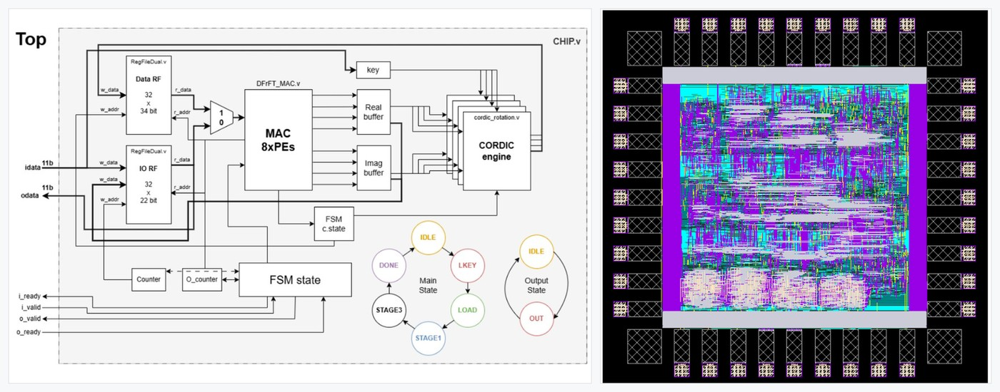
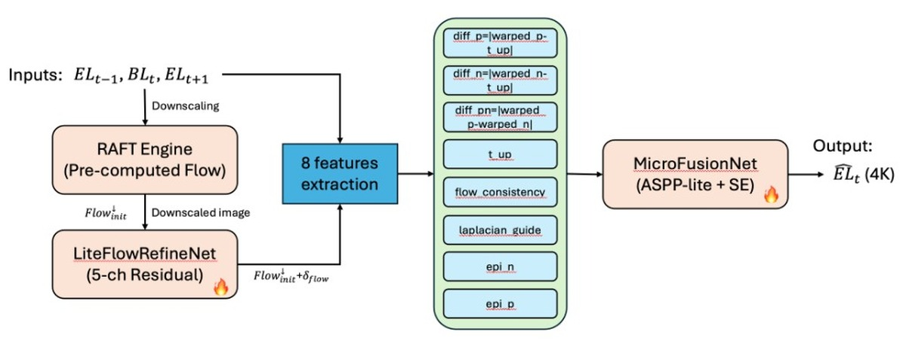
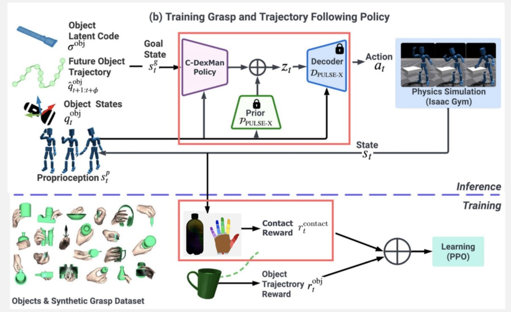
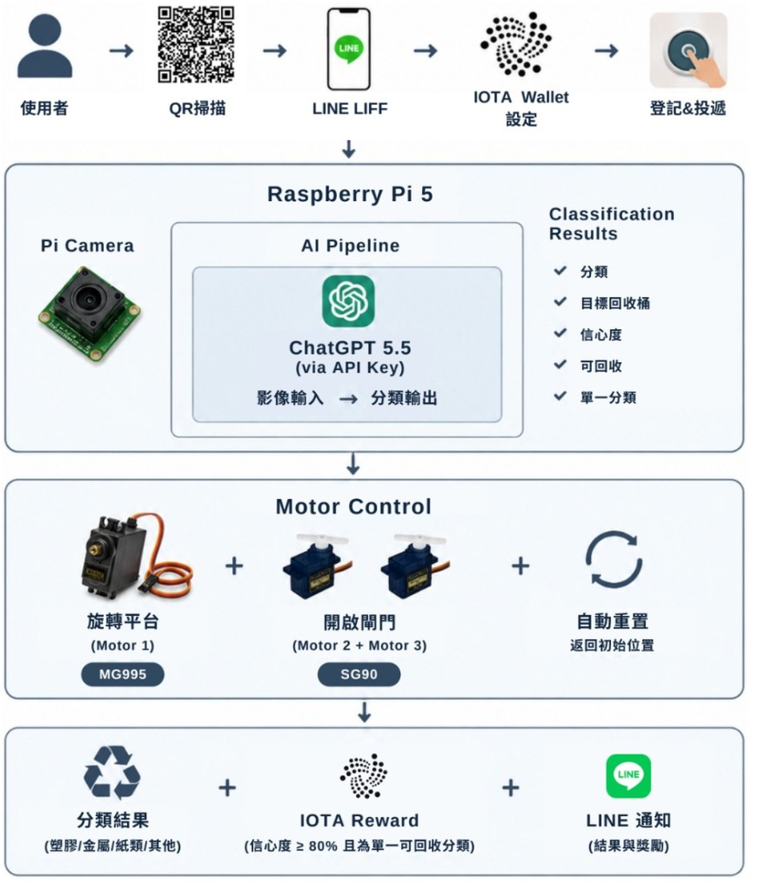
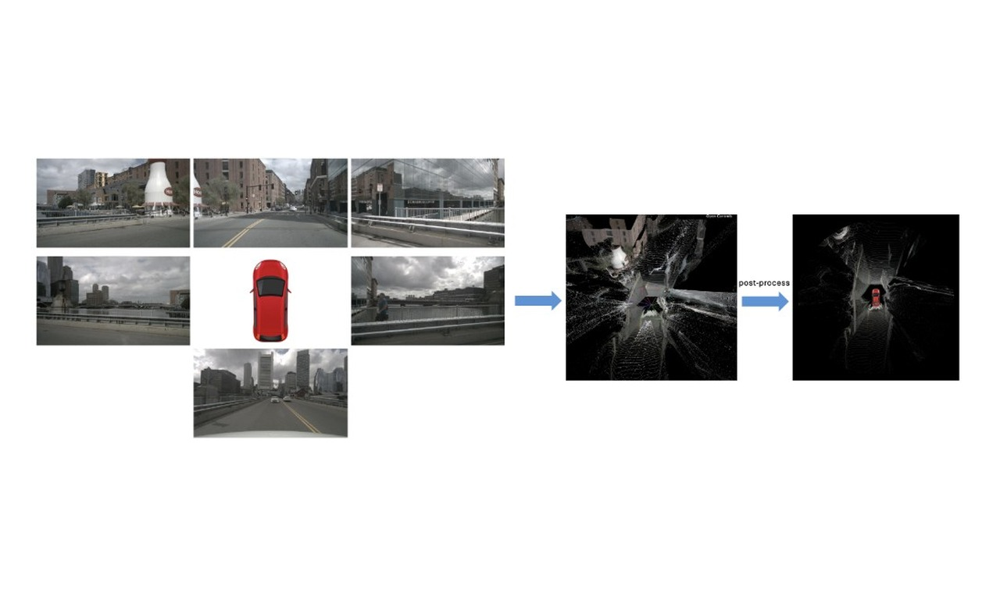

I am a senior undergraduate student in **Electrical Engineering** at **National Taiwan University**, currently an exchange student at the **University of Washington**. My research interests lie in **computer vision**, **robotics**, and **embodied AI**, particularly how intelligent systems can perceive, reason about, and interact with the physical world.

I have worked on research and projects across these areas. At NTU, I conduct research with **[Prof. Yu-Chiang Frank Wang](https://vllab.ee.ntu.edu.tw/ycwang.html)** on camera pose estimation under extremely low visual overlap, investigating how generated intermediate observations and geometric consistency affect 3D perception. At UW, I work with **[Prof. Jenq-Neng Hwang](https://people.ece.uw.edu/hwang/)** on autonomous robotics, developing scene-graph and spatial-memory modules for a healthcare  Unitree Quadruped Robot and exploring contact-aware world models for human-object interaction base on SuperMimic. My broader project experience includes contact-guided humanoid manipulation, vision-language-action models, and efficient video generation.

Beyond research, I enjoy exploring new technologies and participating in campus activities. I have performed in NTUEE Night's Light Dance, contributed to its software development team, and served as Student Affairs Director of the Country Youth Life Study Club, where I organized events and mentored incoming students. These experiences have strengthened my appreciation for creativity, collaboration, and learning from people with different perspectives.

## News
{: #news}

* **[Sep. 2026]** Began exchange semester at the University of Washington.
* **[Jun. 2026]** Won **2nd place (presentation)** and **3rd place (performance)** in the MediaTek Frame Generation Final Project Competition with *Life-RAFT*.
* **[May 2026]** Won **3rd place** in the MakeNTU Logitech Challenge.

## Research Experience
{: #research-experience}

  

    
Healthcare Robotic Dog: Scene Graph and Spatial Memory

    
Oct. 2026 – Present

  

  
<a href="https://ipl-uw.github.io/index.html">Information Processing Lab, UW</a>

  
Scene-graph modules for navigation and language-guided reasoning on a quadruped platform.

  

    
Low-Overlap Camera Pose Estimation with Generated Bridge Frames

    
Feb. 2026 – Present

  

  
<a href="https://vllab.ee.ntu.edu.tw/">Vision and Learning Lab, NTU</a>

  
Intermediate-frame generation for low-overlap pose estimation with VGGT/DUSt3R; MEt3R-guided masking and consistency-based methods.

## Education
{: #education}

  

    
Exchange Student, University of Washington

    
Sep. 2026 – Dec. 2026

  

  
Seattle, WA, USA

  

    
B.S. in Electrical Engineering, National Taiwan University

    
Sep. 2023 – Present

  

  
Taipei, Taiwan

  
GPA: 4.17/4.3 | Rank: 32/255 (Top 12.5%)

  

    
Class of Science, Taipei Municipal Chien Kuo High School

    
Sep. 2020 – Jun. 2023

  

## Selected Projects
{: #selected-projects}

  

    

      
    

    

      
Multiplier-Free 32-Point DFrFT Accelerator

      
Feb. 2026 – Jun. 2026 · Advisor: Prof. Tzi-Dar Chiueh

      
Designed a multiplier-free discrete fractional Fourier transform accelerator with CSD shift-and-add PEs and CORDIC engines, and completed full RTL-to-layout in UMC 0.18 µm. Achieved <strong>85 MHz</strong>, <strong>~0.04 mW</strong>, and <strong>2.208 mm²</strong> post-layout.

    

  

  

    

      
    

    

      
Life-RAFT

      
May 2026 – Jun. 2026 · MediaTek Frame Generation Competition

      
Built a lightweight 4K frame-generation pipeline using RAFT optical flow, backwarping, and geometric fusion from a 1080p frame plus neighboring 4K references. Won <strong>2nd place (presentation)</strong> and <strong>3rd place (performance)</strong>.

    

  

  

    

      
    

    

      
Contact-Guided Policy Learning for Humanoid Dexterous Manipulation

      
Oct. 2025 – Dec. 2025

      
Trained a PPO policy for humanoid dexterous grasping using contact-based rewards. Predicted object contact maps from a single RGB image with Trellis2 and ContactGen to guide more stable, physically plausible grasps.

    

  

  

    

      
    

    

      
AI Smart Recycling Bin

      
May 2026 – Jun. 2026

      
Built an AIoT recycling system on Raspberry Pi 5 that classifies recyclables with a vision-language model. Integrated LINE LIFF, IOTA wallet rewards, and AWS for end-to-end user incentive tracking.

    

  

  

    

      
    

    

      
VGGT-Based BEV Visualization

      
May 2026 – Jun. 2026 · Intelligent Vehicles

      
Developed a training-free pipeline that reconstructs 3D scenes from six surround-view cameras with VGGT and projects them to bird’s-eye view. Recognized as a <strong>top-3</strong> final project in Intelligent Vehicles.

    

  

## Leadership & Activities
{: #leadership}

  

    
NTUEE Night — Performance & Technical Team

    
Jan. 2025 – May 2026

  

  
Coordinated hip-hop dance performances, designed costumes for Light Dance, and contributed to the software backend team. Combined creative collaboration with technical development to support student-led performances.

  

    
NTU iOS Club — Member

    
Sep. 2025 – Jan. 2026

  

  
Explored SwiftUI development and exchanged technical ideas with fellow students, expanding my interests in software development beyond academic coursework.

  

    
Student Affairs Director — Country Youth Life Study Club

    
Sep. 2023 – Jun. 2024

  

  
Recruited and mentored incoming students, organized social events and trips, and helped foster an inclusive and supportive student community.

